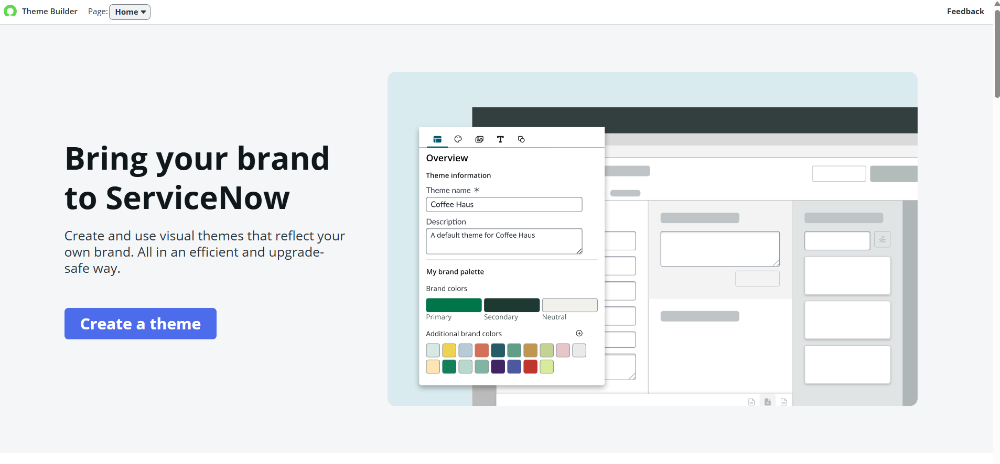
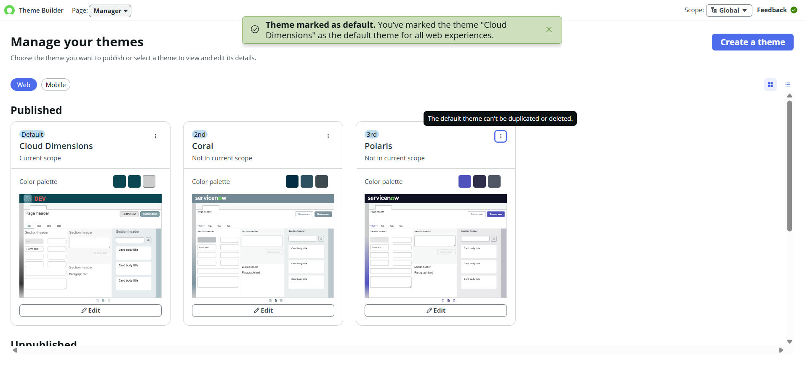
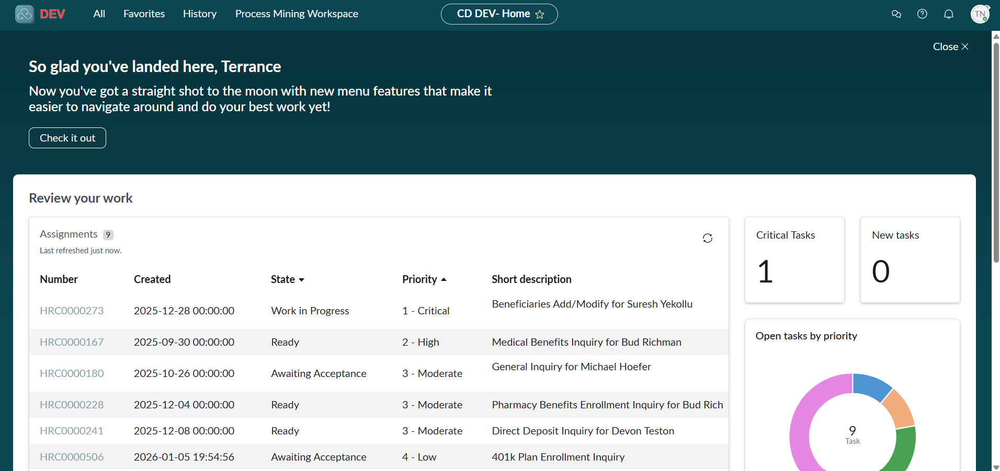

# SNAF Module 2: Explore the Power of the ServiceNow Platform

## Overview
Covers the value of a baseline implementation, what a ServiceNow instance is, how to configure an instance to reflect a company's brand image and label instance tabs for clarity, and how to install applications and plugins.

## User Story
As the marketing communications coordinator, the instance needs to comply with the company brand image.

As a developer, instances in use need to be clearly differentiated from one another.

## Labs

### 2.1.1: Configure an Instance

**Objective:** Configure a ServiceNow instance to reflect Cloud Dimensions' brand identity using Theme Builder, and establish clear visual differentiation between the company's three environment copies.

**Steps Taken:**
1. Opened Theme Builder and created a new theme named "Cloud Dimensions"
2. Uploaded the company's brand colours, logo, and theme details as provided in the requirements

3. Published the theme and marked it as the Default Theme for the instance

4. Marked the browser tab label as "CD DEV" to visually distinguish the Development instance from other environment copies
5. Impersonated a user to verify the branding applied correctly across the platform

**Concept Reinforced:** Instance configuration serves both brand and operational needs at once. Theme Builder addresses the business requirement (brand compliance), while environment labelling (CD DEV) addresses the technical requirement of distinguishing between multiple instance copies, both called for in the module's user story.

## Key Concepts Reinforced
- A ServiceNow instance can be configured (branding, tab labels) to make it instantly recognizable, which matters when multiple instances (dev, test, prod) are in use side by side
- Instance configuration serves two different stakeholders at once: business/brand needs (marketing) and technical/operational needs (developers telling instances apart)
