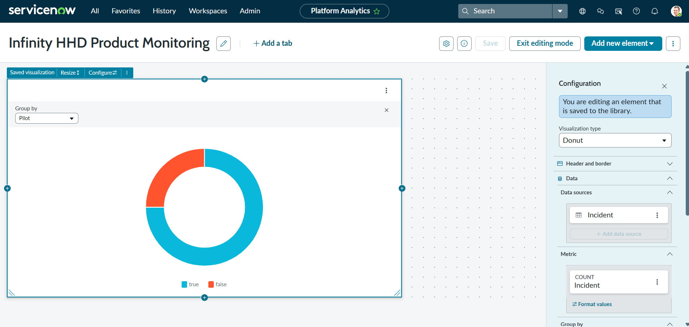
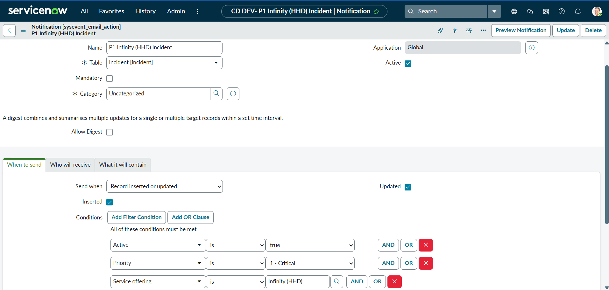
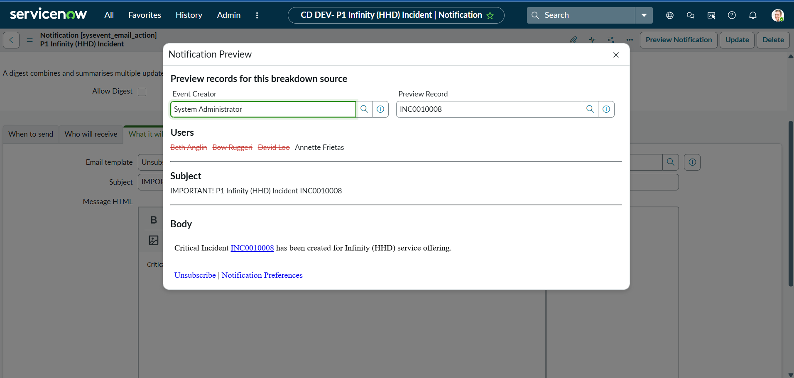

# SNAF Module 6: Enable Productivity

## Overview
Covers supporting Fulfillers and Agents, building visualizations from various sources, adding a visualization to a dashboard, a basic understanding of Platform Analytics, creating notifications, and identifying productivity tools.

## Labs

### Section 6.1: Platform Analytics Experience
**User story:** As the IT Product Owner, a dashboard is needed to monitor the Infinity (HHD) Service offering, including a visualization showing HHD incident records by Pilot versus Non-Pilot and Firmware vs. Non-Firmware.

### 6.1.1: Create a Visualization and Dashboard

**Objective:** Give the IT Product Owner a single place to monitor the Infinity HHD service offering, including a self-service way to build visualizations. Requirements: (1) a dashboard for monitoring the service offering, (2) a visualization from a list showing HHD incident records by Pilot vs. Non-Pilot and Firmware vs. Non-Firmware.

**Steps Taken:**
1. Created a new dashboard named "Infinity HHD Product Monitoring" using the In-line editor, which allows dragging and dropping components directly onto the page
2. Built a visualization with dynamic grouping to show HHD incident records in multiple ways (Incident vs. Inquiry, Pilot vs. Non-Pilot, Firmware vs. Non-Firmware)
3. Created a visualization from a list, which launched the Visualization Designer, and configured it there
4. Bookmarked the visualization and added it to the dashboard

5. Shared the dashboard with the Training Technology Support group, granting access to both the visualization and dashboard

**Concept Reinforced:** A dashboard and its visualizations are separate but linked objects; a visualization can be built and configured independently, then attached to one or more dashboards, and sharing/access needs to be granted at both levels for the right group to see it.

### Section 6.2: Notifications
**User story:** As the IT Product Owner for the Infinity HHD, a notification is needed whenever a critical (P1) incident is created for the Infinity (HHD) Service offering. Training Technology Support group members will receive an email for critical (P1) incidents.

### 6.2.1: Configure Notifications

**Objective:** Let the IT Product Owner for the Infinity (HHD) be notified whenever a critical (P1) incident is created for the Infinity (HHD) Service offering, with Training Technology Support group members receiving an email for critical (P1) incidents.

**Steps Taken:**
1. Enabled the Show/Hide annotations option during setup, since annotations display useful contextual information on various forms
2. Defined the notification to alert the owner of the Training service and the owner of the Infinity (HHD) Service offering whenever a critical (P1) Infinity (HHD) incident is active, triggered on both record creation and update
3. Configured the notification across its three tabs: When to Send, Who Will Receive, and What It Will Contain

4. Created a test incident to trigger the notification and verified it sent correctly

**Concept Reinforced:** Notification configuration splits cleanly into three concerns (trigger conditions, recipients, message content), and testing with a real triggering record is the reliable way to confirm the notification fires as intended, rather than assuming the configuration is correct.

### Section 6.3: Additional Configurations
**User story:** As the administrator, plugins and features in the Platform can be utilized, and Now Assist can be integrated throughout the company's instance.

No numbered lab is listed for this section; only the conceptual coverage of plugins, platform features, and Now Assist integration.

## Key Concepts Reinforced
- Platform Analytics turns raw incident data into visualizations and dashboards that support decision-making at the service level (e.g., Pilot vs. Non-Pilot HHD performance)
- Notifications tie specific record conditions (like a P1 incident) to automated communication for the right group, reducing reliance on manual monitoring
- Productivity tooling in ServiceNow spans reporting, alerting, and platform-level features (plugins, Now Assist) that extend beyond core ITSM workflows.
