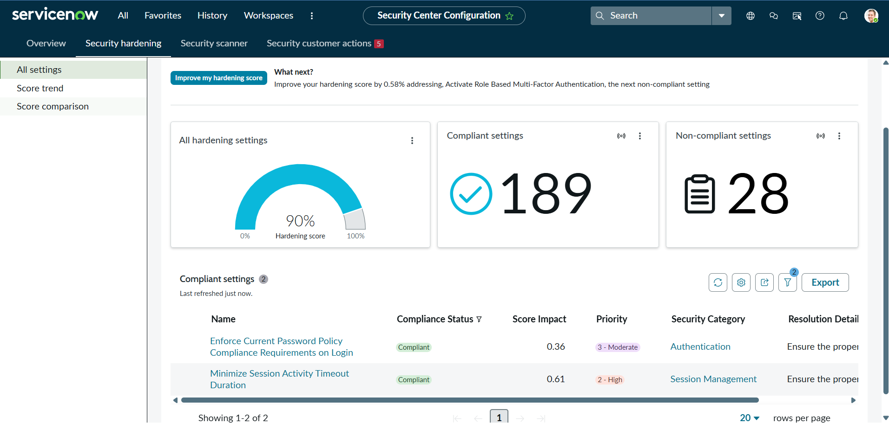

# SNAF Module 8: Securing a ServiceNow Instance

## Overview
Covers key security responsibilities as a data owner under the Shared Responsibility Model, the importance of maintaining an up-to-date security contact in Now Support, locating and effectively using the ServiceNow Security Center (applying instance updates/patches, configuring security settings), summarizing SSC's key features and benefits, and planning regular Security Center reviews with leadership and security teams.

## Labs

### Section 8.1: Shared Responsibility Model
**User story:** As an administrator, an understanding of the responsibility for securing the ServiceNow instance is needed, according to the Shared Responsibility Model.

No numbered lab is listed for this section; only the conceptual coverage of the Shared Responsibility Model.

### Section 8.2: ServiceNow Security Center
**User story:** As an administrator, the ServiceNow Security Center needs to be navigated with ease to improve security and compliance in the Now Platform, monitoring for security-related actions and behaviors across instances.

- ### 8.2.1: Exploring Security Center

**Objective:** Navigate the ServiceNow Security Center to improve security and compliance in the Now Platform, focusing on non-compliant hardening settings and understanding their impact on the overall compliance score.

**Steps Taken:**
1. Explored the Hardening compliance score and its breakdown, focusing on the Non-Compliant Settings list

2. Reviewed the Score Impact column to understand how much each setting would raise the overall score if made compliant
3. Configured two hardening settings from the non-compliant list: "Enforce Current Password Policy Compliance Requirements on Login" and "Minimize Session Activity Timeout Duration"
4. Verified the Hardening compliance score increased from 89% to 90% as a result, with both settings now reflected under Compliant Settings

**Concept Reinforced:** The Security Center quantifies security posture as a single score but breaks it down into individually actionable settings, each with its own Score Impact, so remediation can be prioritized by what moves the score the most rather than by addressing settings randomly.

## Key Concepts Reinforced
- The Shared Responsibility Model draws a clear line between what ServiceNow secures at the platform level and what the customer, as data owner, is responsible for
- The Security Center centralizes visibility into an instance's security posture: hardening settings, best practices, and overall compliance status, in one dashboard rather than scattered across separate admin screens
- Security is not a one-time setup; it requires ongoing reviews with leadership and security teams to stay current.
