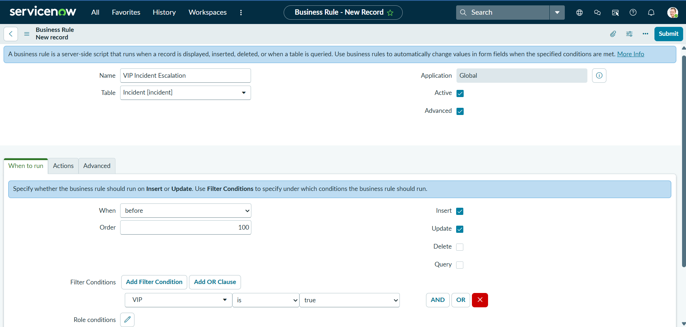
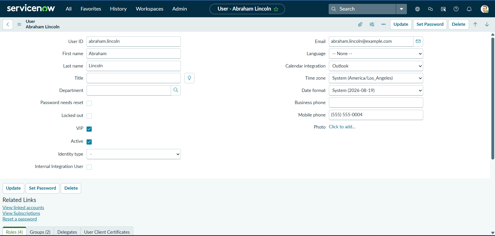
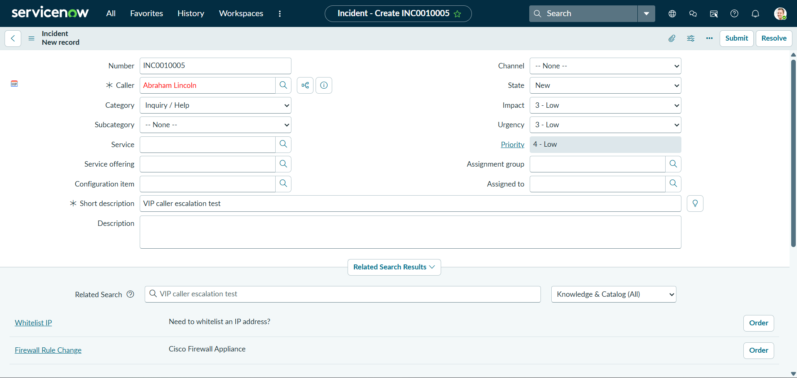
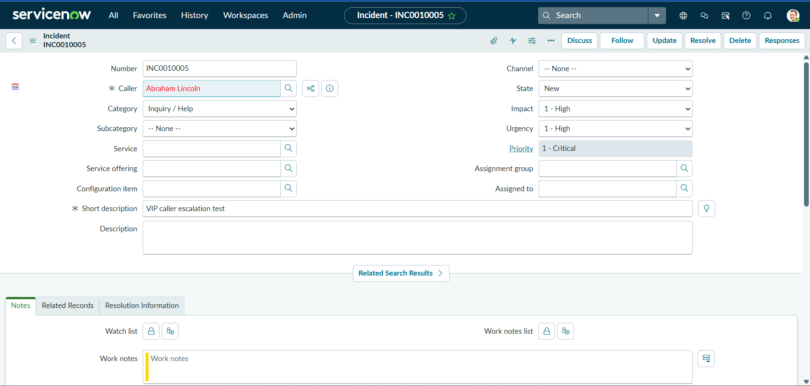
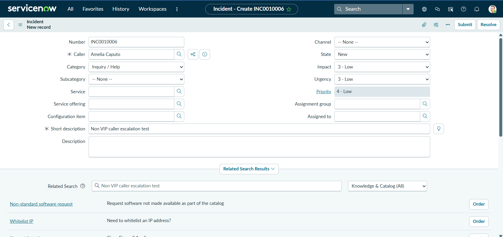
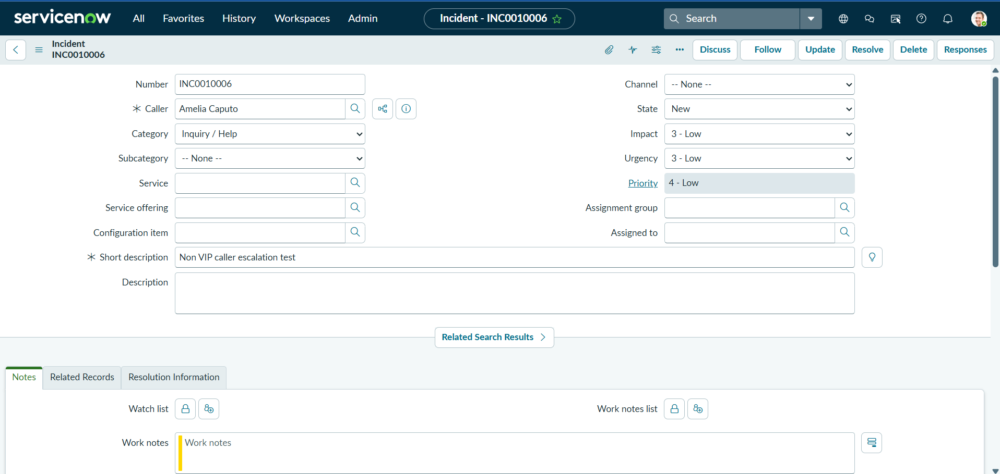

# VIP Incident Escalation

## Overview

This project demonstrates the implementation of a ServiceNow Business Rule that automatically escalates an Incident when the selected caller is identified as a VIP.

The solution uses a Before Business Rule on the Incident table to set Impact and Urgency to High when the caller's VIP attribute is enabled. ServiceNow then calculates the resulting Incident Priority.

The solution was implemented and tested in a ServiceNow Personal Developer Instance (PDI).

## Environment

| Item | Details |
| --- | --- |
| Platform | ServiceNow |
| Instance | Personal Developer Instance (PDI) |
| Release | Australia |
| Application | Global |
| Table | Incident [incident] |

## Business Requirement

Incidents involving VIP users may require increased attention and prioritisation.

The requirement was to configure ServiceNow so that when an Incident is created or updated with a VIP caller:

1. Impact is automatically set to `1 High`.
2. Urgency is automatically set to `1 High`.
3. ServiceNow calculates the resulting Priority.
4. Incidents involving non VIP callers are not affected by the VIP escalation logic.

## Solution

A Before Business Rule named `VIP Incident Escalation` was configured on the Incident table.

The rule runs when an Incident is inserted or updated. It evaluates the VIP attribute of the user referenced by the Incident's Caller field.

When the caller is a VIP, the Business Rule sets Impact and Urgency to `1 High`. The resulting Priority is then calculated by ServiceNow.

## Business Rule Configuration

| Setting | Value |
| --- | --- |
| Name | VIP Incident Escalation |
| Table | Incident [incident] |
| Application | Global |
| Active | Yes |
| Advanced | Yes |
| When | Before |
| Order | 100 |
| Insert | Yes |
| Update | Yes |
| Delete | No |
| Query | No |

### Condition

The Business Rule uses the following condition:

`Caller → VIP → is → true`

The condition uses dot walking through the Incident's Caller reference to evaluate the VIP field on the referenced User record.

In the completed condition builder, the dot-walked field is displayed as `VIP`.



## Business Rule Script

The Business Rule uses the following server-side script:

```javascript
(function executeRule(current, previous) {

    current.setValue('impact', 1);
    current.setValue('urgency', 1);

})(current, previous);
```

The script modifies the Incident's Impact and Urgency values before the record is saved.

The script does not directly set priority. Instead, ServiceNow calculates Priority based on the resulting Impact and Urgency values.

## Testing

Two test scenarios were performed to validate the Business Rule.

| Test | Caller Type | Expected Behaviour |
| --- | --- | --- |
| Test Case 1 | VIP | Incident should be escalated |
| Test Case 2 | Non VIP | VIP escalation should not occur |

Both Incidents were created with the same initial Impact, Urgency, and Priority values to provide a consistent comparison.

Both started at:

Impact 3 Low, Urgency 3 Low, Priority 4 Low.

### Test Case 1: VIP Caller

#### Test Objective

Verify that an Incident is automatically escalated when the selected caller has the VIP attribute enabled.

#### Test User

Abraham Lincoln was selected as the VIP test user.

The User record confirms that the `VIP` attribute is enabled.



#### Incident Before Submission

A new Incident was prepared with Abraham Lincoln as the caller.

The Incident had the following values before submission:

| Field | Value |
| --- | --- |
| Caller | Abraham Lincoln |
| Short description | VIP caller escalation test |
| Impact | 3 Low |
| Urgency | 3 Low |
| Priority | 4 Low |



#### Expected Result

After submission, the Business Rule should identify the caller as a VIP and:

* Change Impact from `3 Low` to `1 High`
* Change Urgency from `3 Low` to `1 High`
* Result in Priority being calculated as `1 Critical`

#### Actual Result

After the Incident was submitted, the following changes occurred:

| Field | Before | After |
| --- | --- | --- |
| Impact | 3 Low | 1 High |
| Urgency | 3 Low | 1 High |
| Priority | 4 Low | 1 Critical |



The Business Rule successfully identified the VIP caller and applied the escalation logic.

**Test Result: PASS**

### Test Case 2: Non VIP Caller

#### Test Objective

Verify that the VIP escalation logic is not applied when the selected caller does not have the VIP attribute enabled.

#### Test User

Amelia Caputo was selected as the non VIP test user.

The User record confirms that the `VIP` attribute is not enabled.


#### Incident Before Submission

A new Incident was prepared with Amelia Caputo as the caller.

The Incident had the following values before submission:

| Field | Value |
| --- | --- |
| Caller | Amelia Caputo |
| Short description | Non VIP caller escalation test |
| Impact | 3 Low |
| Urgency | 3 Low |
| Priority | 4 Low |



#### Expected Result

Because the caller is not a VIP, the Business Rule condition should evaluate to false and the VIP escalation logic should not execute.

The Incident should retain its existing Impact and Urgency values.

#### Actual Result

After submission, the Incident values remained unchanged:

| Field | Before | After |
| --- | --- | --- |
| Impact | 3 Low | 3 Low |
| Urgency | 3 Low | 3 Low |
| Priority | 4 Low | 4 Low |



The result confirms that the VIP escalation logic was not applied to the non VIP caller.

**Test Result: PASS**

## Test Summary

| Test Case | Expected Result | Actual Result | Status |
| --- | --- | --- | --- |
| VIP Caller | Escalate Incident | Impact and Urgency changed to 1 High, resulting in Priority 1 Critical | PASS |
| Non VIP Caller | No VIP escalation | Impact, Urgency and Priority remained unchanged | PASS |

The positive and negative test scenarios confirm that the Business Rule applies the escalation logic only when the Incident caller is identified as a VIP.

## Key Learning

This project provided practical experience with:

* Creating and configuring Business Rules
* Using Before Business Rules
* Server-side scripting
* Working with the `current` object
* Reference fields and dot walking
* Configuring Business Rule conditions
* Incident Impact and Urgency
* ServiceNow Priority calculation
* Positive and negative test scenarios
* Validating automated record behaviour

## Technical Observations

### Dot Walking

The VIP attribute belongs to the User record rather than directly to the Incident record.

Because Caller is a reference field, the Business Rule condition uses dot walking through Caller to access the referenced user's VIP attribute.

### Before Business Rule

A Before Business Rule was used because the Incident values needed to be modified before the database operation completed.

The script modifies the `current` Incident record directly without requiring an additional record update.

### Priority Calculation

The Business Rule does not directly set the Priority field.

Instead, it sets Impact and Urgency to `1 High`. ServiceNow then calculates the resulting Priority as `1 Critical`.

This keeps the automation aligned with the relationship between Impact, Urgency, and Priority.

## Outcome

The VIP Incident Escalation Business Rule was successfully implemented and tested.

For the VIP test case, an Incident with an initial Impact of `3 Low`, Urgency of `3 Low` and Priority of `4 Low` was automatically changed to Impact `1 High`, Urgency `1 High` and Priority `1 Critical`.

For the non VIP test case, the same initial values remained unchanged after submission.

The results demonstrate that the Business Rule correctly applies the escalation logic when the caller is a VIP while leaving non VIP Incidents unaffected.
