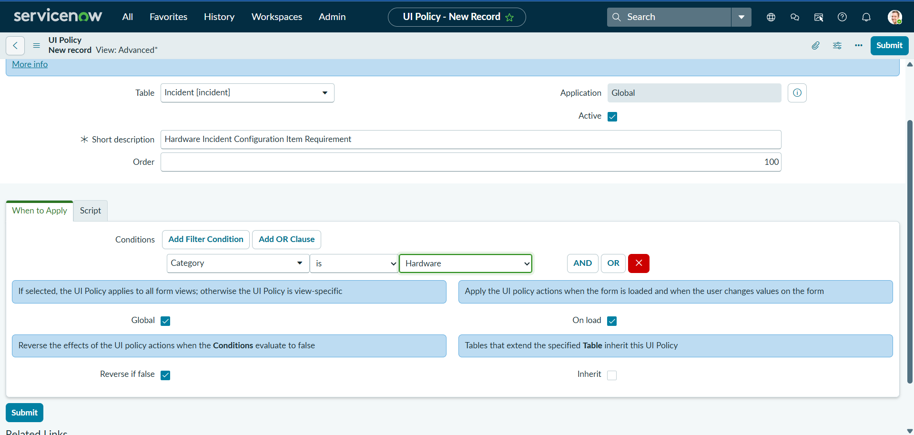
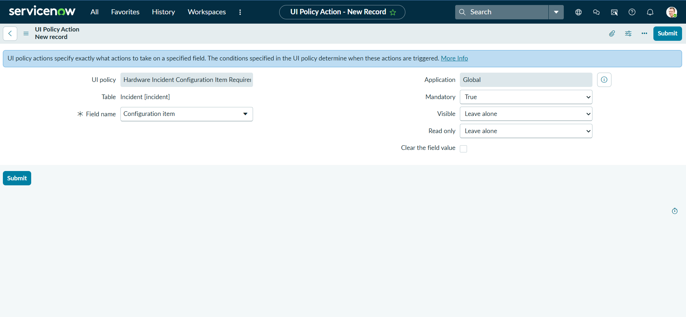
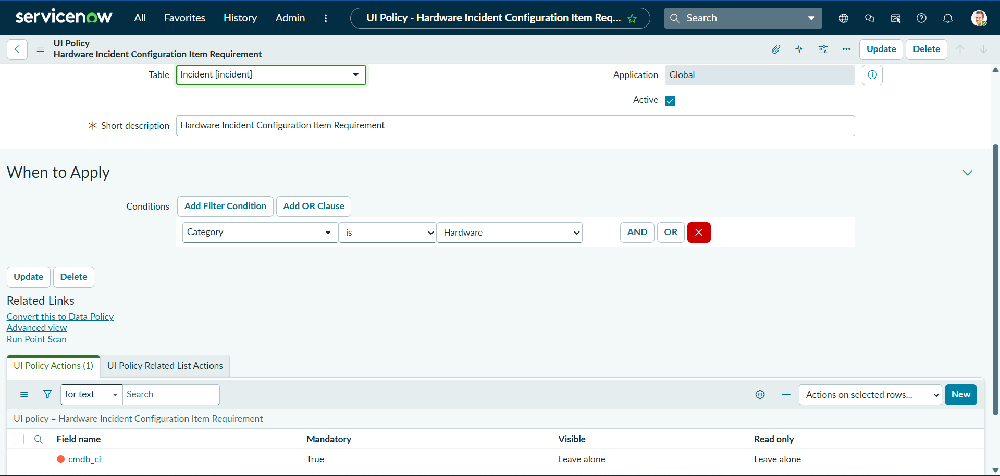
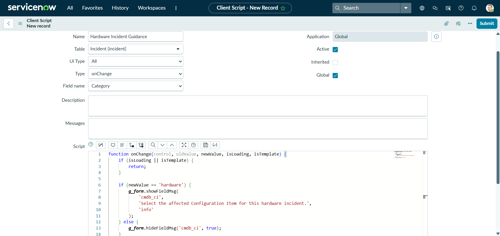
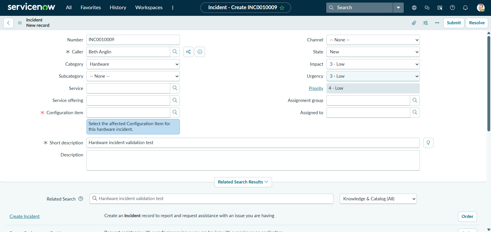
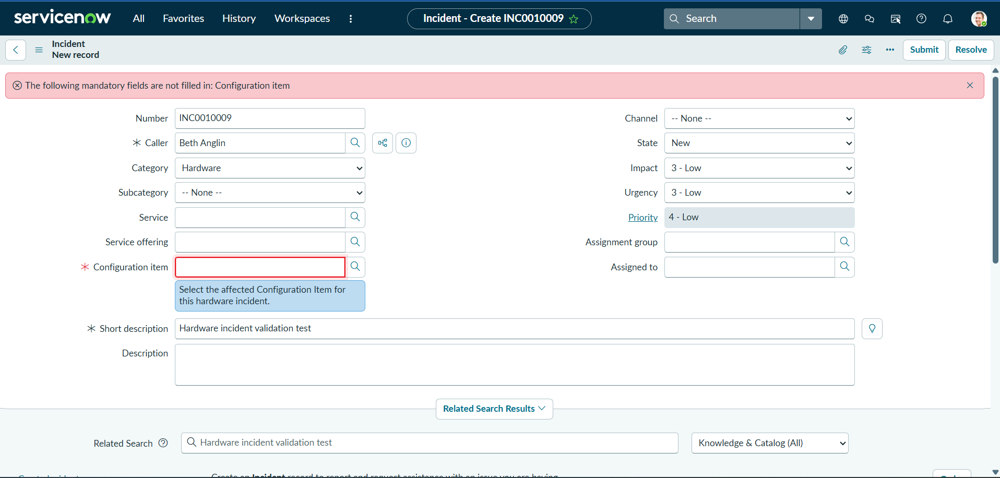
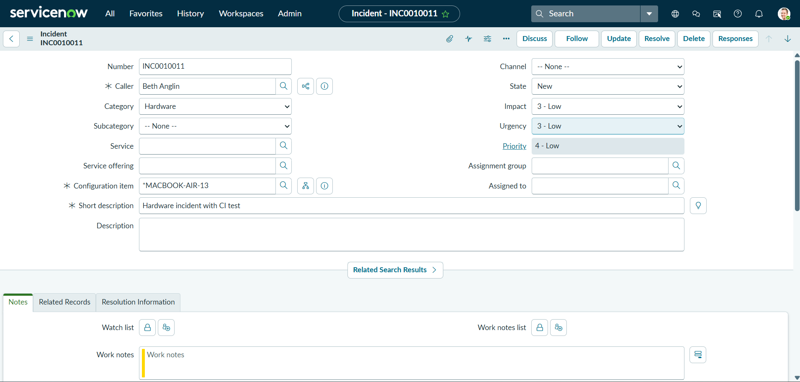
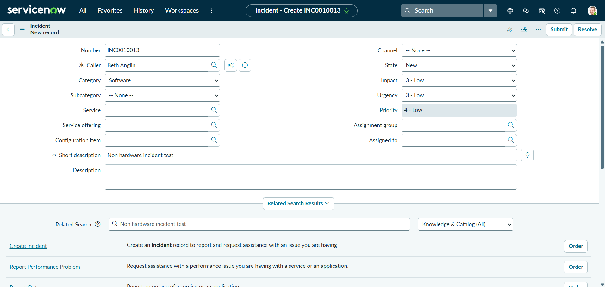
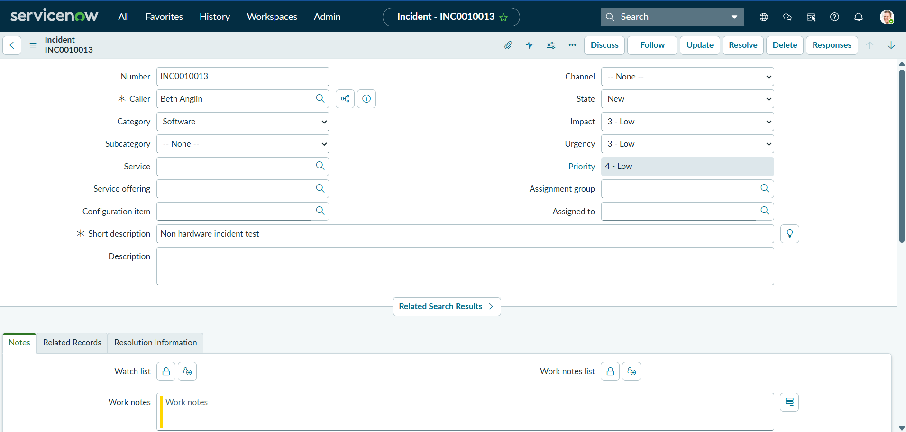

# Hardware Incident CI Enforcement

## Overview

This project demonstrates the use of ServiceNow UI Policies, UI Policy Actions, and Client Scripts to dynamically control Incident form behaviour.

When an Incident is categorised as Hardware, the Configuration Item field becomes mandatory, and contextual guidance prompts the user to identify the affected Configuration Item.

For non-Hardware incidents, the Configuration Item remains optional.

The solution was implemented and tested in a ServiceNow Personal Developer Instance (PDI).

## Environment

| Item | Details |
| --- | --- |
| Platform | ServiceNow |
| Instance | Personal Developer Instance (PDI) |
| Release | Australia |
| Application | Global |
| Table | Incident [incident] |

## Business Requirement

Hardware incidents should identify the affected Configuration Item so that the Incident can be associated with the relevant device or infrastructure component.

The requirement was to configure the Incident form so that:

1. Selecting **Hardware** makes Configuration Item mandatory.
2. The user receives contextual guidance to select the affected Configuration Item.
3. A Hardware Incident cannot be submitted while the Configuration Item is empty.
4. Other Incident categories are not affected by the Hardware-specific requirement.
5. The Incident can be submitted normally once the requirement is satisfied.

## Solution Design

The solution uses two ServiceNow client-side configuration mechanisms:

1. **UI Policy and UI Policy Action** to dynamically enforce the Configuration Item requirement.
2. **onChange Client Script** to provide contextual guidance when Hardware is selected.

This separates field enforcement from user guidance and avoids unnecessary custom validation.

## UI Policy Configuration

A UI Policy named `Hardware Incident Configuration Item Requirement` was created on the Incident table.

The policy uses the following condition:

`Category is Hardware`

Key settings:

| Setting | Value |
| --- | --- |
| Active | Yes |
| Global | Yes |
| On load | Yes |
| Reverse if false | Yes |
| Order | 100 |

When the condition is true, the associated UI Policy Action is applied. When the condition is false, **Reverse if false** reverses the mandatory field behaviour.



### UI Policy Action

The associated UI Policy Action controls the Configuration Item field.

| Setting | Value |
| --- | --- |
| Field | Configuration item |
| Mandatory | True |
| Visible | Leave alone |
| Read only | Leave alone |
| Clear field value | No |



The completed UI Policy record shows the associated UI Policy Action and confirms that the `cmdb_ci` field is configured as mandatory when the policy condition is satisfied.



## Client Script

An `onChange` Client Script named `Hardware Incident Guidance` was created on the Incident table.

The script monitors changes to the Category field and provides contextual guidance when Hardware is selected.

| Setting | Value |
| --- | --- |
| Name | Hardware Incident Guidance |
| Table | Incident [incident] |
| Type | onChange |
| Field name | Category |
| UI Type | All |
| Active | Yes |

### Script

```javascript
function onChange(control, oldValue, newValue, isLoading, isTemplate) {
    if (isLoading || isTemplate) {
        return;
    }

    if (newValue == 'hardware') {
        g_form.showFieldMsg(
            'cmdb_ci',
            'Select the affected Configuration Item for this hardware incident.',
            'info'
        );
    } else {
        g_form.hideFieldMsg('cmdb_ci', true);
    }
}
```

When Category is set to Hardware, `g_form.showFieldMsg()` displays an informational message beneath the Configuration Item field.

When the Category changes away from Hardware, `g_form.hideFieldMsg()` removes the message.

The Client Script provides user guidance only. The mandatory field requirement is handled by the UI Policy and UI Policy Action.



## Functional Testing

Three test scenarios were performed to validate both the Hardware-specific behaviour and the behaviour for other Incident categories.

### Test 1: Hardware Incident Without Configuration Item

**Objective:** Verify that a Hardware Incident cannot be submitted without selecting a Configuration Item.

**Test data:**

| Field | Value |
| --- | --- |
| Caller | Beth Anglin |
| Category | Hardware |
| Configuration Item | Empty |
| Short description | Hardware incident validation test |

After Hardware was selected, Configuration Item became mandatory, and the Client Script displayed the guidance message:

`Select the affected Configuration Item for this hardware incident.`



#### Expected Result

ServiceNow should prevent submission while the mandatory Configuration Item field remains empty.

#### Actual Result

When Submit was selected, ServiceNow prevented the Incident from being created and displayed the mandatory field warning:

`The following mandatory fields are not filled in: Configuration item`



**Test Result: PASS**

### Test 2: Hardware Incident With Configuration Item

**Objective:** Verify that a Hardware Incident can be submitted successfully when a Configuration Item is selected.

**Test data:**

| Field | Value |
| --- | --- |
| Caller | Beth Anglin |
| Category | Hardware |
| Configuration Item | MACBOOK-AIR-13 |
| Short description | Hardware incident with CI test |

Before submission, the Hardware category was selected, and the required Configuration Item was provided.


#### Expected Result

The Incident should be submitted successfully because the mandatory Configuration Item requirement has been satisfied.

#### Actual Result

The Incident was created successfully, and the selected Configuration Item remained associated with the saved Incident.



**Test Result: PASS**

### Test 3: Non-Hardware Incident

**Objective:** Verify that the Hardware-specific requirement does not affect Incidents assigned to another category.

**Test data:**

| Field | Value |
| --- | --- |
| Caller | Beth Anglin |
| Category | Software |
| Configuration Item | Empty |
| Short description | Non hardware incident test |

With Software selected as the Category, Configuration Item remained optional, and the Hardware guidance message was not displayed.



#### Expected Result

The Incident should be submitted successfully without a Configuration Item because the Hardware-specific UI Policy condition is not satisfied.

#### Actual Result

The Incident was created successfully without a Configuration Item.



**Test Result: PASS**

## Test Summary

| Test | Scenario | Expected Result | Status |
| --- | --- | --- | --- |
| Test 1 | Hardware without Configuration Item | Submission prevented | PASS |
| Test 2 | Hardware with Configuration Item | Submission successful | PASS |
| Test 3 | Software without Configuration Item | Submission successful | PASS |

All three test scenarios produced the expected results.

## Technical Decision

An `onSubmit` Client Script was initially evaluated to provide additional validation when a Hardware Incident was submitted without a Configuration Item.

Testing confirmed that this additional validation was unnecessary. Once the UI Policy made Configuration Item mandatory, ServiceNow's native mandatory field validation already prevented submission when the field was empty.

The additional `onSubmit` Client Script was therefore removed from the final solution to avoid duplicating native platform behaviour.

The final design uses:

* **UI Policy:** Determines when the Hardware-specific requirement applies.
* **UI Policy Action:** Makes Configuration Item mandatory.
* **onChange Client Script:** Provides contextual guidance to the user.
* **Native ServiceNow validation:** Prevents submission when the mandatory field is empty.

  ## Skills Demonstrated

This project demonstrates practical experience with:

* UI Policies
* UI Policy Actions
* Client Scripts
* onChange events
* GlideForm (`g_form`)
* Conditional form behaviour
* Dynamic mandatory fields
* Configuration Item references
* Incident Management
* Native ServiceNow form validation
* Positive and negative functional testing

## Key Learning

This project demonstrated how declarative configuration and client-side scripting can work together in ServiceNow.

The mandatory Configuration Item requirement was implemented using a UI Policy and UI Policy Action, while the Client Script was used specifically to improve the user experience through contextual guidance.

Testing also demonstrated the importance of avoiding unnecessary customisation. ServiceNow's native mandatory field validation already enforced the required behaviour, so additional onSubmit scripting was not needed.

The final solution therefore uses native platform capabilities where possible and custom scripting only where it adds additional value.
