# Strategic Investment Governance Application

## Project Overview

This project demonstrates the design and configuration of a custom Strategic Investment Governance application in ServiceNow. The application provides a structured process for capturing, evaluating, reviewing, and governing investment proposals aligned with organisational strategic priorities.

The solution supports investment proposal scoring, controlled governance status transitions, role-based access, automated decision auditing, and portfolio-level reporting and analytics.

The project was developed and tested in a ServiceNow Personal Developer Instance (PDI) using realistic warehouse and operational investment scenarios.

## Business Problem

Organisations may receive multiple investment proposals competing for limited funding and resources. Without a structured governance process, proposals can be evaluated inconsistently, approval stages may be unclear, decision accountability can be limited, and management may lack visibility across the investment portfolio.

This project addresses these challenges by providing a centralised ServiceNow solution for capturing investment proposals, evaluating them against consistent criteria, controlling their progression through defined governance stages, and providing portfolio-level visibility through reporting and analytics.

## Project Objectives

The solution was designed to:

- Centralise the creation and management of investment proposals.
- Align proposals with defined organisational strategic priorities.
- Evaluate proposals consistently using weighted strategic, financial, operational, and risk criteria.
- Automatically calculate an Evaluation Score for each proposal.
- Enforce a controlled governance lifecycle from Draft through final decision.
- Separate proposal requestor and governance reviewer responsibilities using role-based access control.
- Require justification when proposals are deferred or rejected.
- Automatically capture decision accountability through Decision By and Decision Date.
- Provide portfolio-level reporting and an interactive governance dashboard.

## Solution Requirements

The application was designed around the following functional and technical requirements:

1. **Investment Proposal Management**  
   Provide a dedicated record to capture proposal details, including title, description, business justification, estimated cost, expected annual benefit, proposed implementation dates, and strategic priority.

2. **Strategic Alignment**  
   Allow each investment proposal to be linked to an organisational Strategic Priority using the ServiceNow Goal Framework.

3. **Weighted Proposal Evaluation**  
   Evaluate proposals using four scoring criteria: Strategic Alignment, Financial Value, Operational Impact, and Risk. Automatically calculate a weighted Evaluation Score from these values.

4. **Controlled Governance Lifecycle**  
   Manage proposals through the defined lifecycle: Draft → Submitted → Under Review → Approved, Deferred, or Rejected, while preventing invalid status transitions.

5. **Role-Based Access Control**  
   Separate requestor and governance reviewer responsibilities so that requestors can manage proposal information but only authorised reviewers can control governance decisions.

6. **Controlled Proposal Submission**  
   Provide requestors with a controlled mechanism to submit Draft proposals for governance review without granting them direct write access to Governance Status.

7. **Decision Controls and Auditability**  
   Require Decision Comments when a proposal is Deferred or Rejected, and automatically record who made the final governance decision and when.

8. **Portfolio Reporting and Analytics**  
   Provide reports and an interactive dashboard showing proposal volumes, governance status, evaluation performance, costs, expected benefits, and proposal-level governance information.

 ## Solution Process Flow

The following process flow illustrates the end-to-end Investment Proposal lifecycle across the **Requestor**, **Governance Reviewer**, and **System / Automation** responsibilities.

It shows how a proposal progresses from creation and Draft status through controlled submission, governance review, final decision, automated decision capture, and portfolio reporting. The diagram also highlights the automated weighted Evaluation Score calculation and the Approved, Deferred, and Rejected governance outcomes.

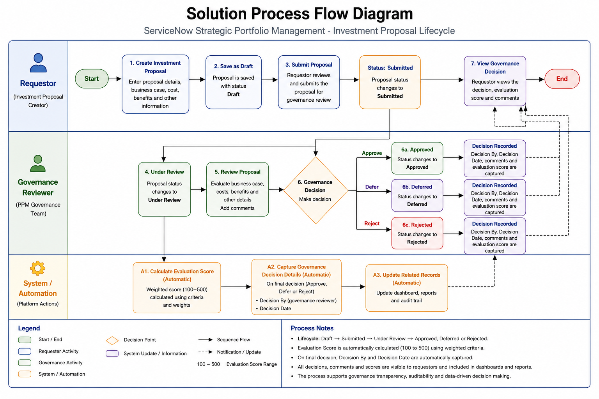

## Application and Data Model

The solution was built around a custom ServiceNow table named **Investment Proposal** (`u_investment_proposal`). The table acts as the central record for capturing investment information, evaluation criteria, governance status, and final decision details.

### Investment Proposal Form

The Investment Proposal form provides a centralised view of proposal information, including strategic alignment, financial information, evaluation criteria, governance status, implementation dates, and business justification.

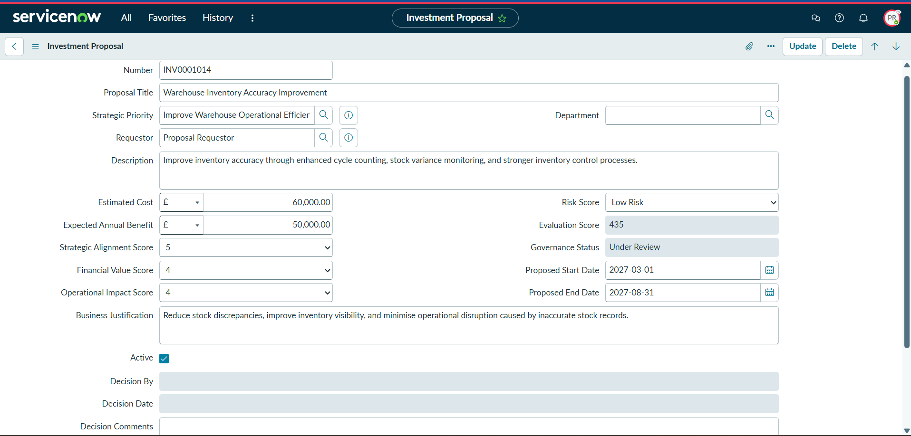

Key fields configured on the Investment Proposal table include:

| Field | Purpose |
|---|---|
| Number | Unique identifier for each investment proposal |
| Proposal Title | Name of the proposed investment |
| Strategic Priority | Links the proposal to a strategic priority |
| Requestor | Identifies the user submitting the proposal |
| Department | Records the organisational department associated with the proposal |
| Description | Provides details of the proposed investment |
| Business Justification | Explains the business need and expected value |
| Estimated Cost | Captures the expected investment cost |
| Expected Annual Benefit | Captures the anticipated annual financial benefit |
| Strategic Alignment Score | Measures alignment with organisational strategy |
| Financial Value Score | Assesses expected financial value |
| Operational Impact Score | Assesses expected operational benefit |
| Risk Score | Assesses investment risk, with higher scores representing lower risk |
| Evaluation Score | Stores the automatically calculated weighted evaluation result |
| Governance Status | Tracks the proposal through the governance lifecycle |
| Proposed Start Date | Planned implementation start date |
| Proposed End Date | Planned implementation completion date |
| Decision By | Records the user responsible for the final governance decision |
| Decision Date | Records when the final decision was made |
| Decision Comments | Captures supporting comments for governance decisions |
| Active | Indicates whether the proposal record is active |

### Strategic Priority Integration

The **Strategic Priority** field was configured as a reference to the ServiceNow Goal Framework Strategic Priority table (`sn_gf_strategy`). This allows investment proposals to be associated with organisational strategic objectives rather than storing strategic priorities as static text.

For testing, proposals were aligned to the strategic priority **Improve Warehouse Operational Efficiency**, providing a realistic operational context for evaluating warehouse investment initiatives.

## Weighted Evaluation Scoring

To provide a consistent method for comparing investment proposals, the application uses four evaluation criteria. Each criterion is scored from **1 to 5**, with higher values representing a more favourable assessment.

The criteria are weighted according to their importance:

| Evaluation Criterion | Weight |
|---|---:|
| Strategic Alignment | 35% |
| Financial Value | 25% |
| Operational Impact | 25% |
| Risk | 15% |

For the Risk Score, **1 represents very high risk, and 5 represents very low risk**, ensuring that a higher value is favourable across all four evaluation criteria.

The Evaluation Score is calculated using:

`(Strategic Alignment × 35) + (Financial Value × 25) + (Operational Impact × 25) + (Risk × 15)`

This produces a possible Evaluation Score between **100 and 500**, where a higher score indicates stronger overall investment value.

### Automated Score Calculation

A **Before Business Rule** named **Calculate Evaluation Score** was configured on the Investment Proposal table. The rule runs on both insert and update and automatically recalculates the Evaluation Score when the proposal is saved.

The following configuration shows the Business Rule running **Before** the database operation, with both **Insert** and **Update** enabled.

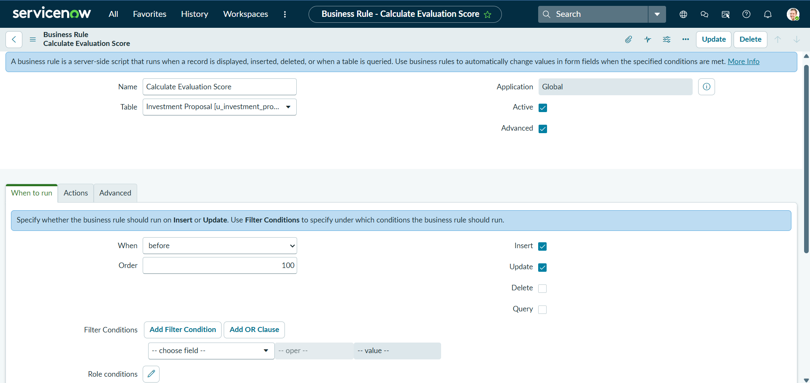

The weighted scoring calculation is implemented using the following server-side script:

```javascript
(function executeRule(current, previous /*null when async*/) {

    var strategic = parseInt(current.u_strategic_alignment_score.getValue(), 10);
    var financial = parseInt(current.u_financial_value_score.getValue(), 10);
    var operational = parseInt(current.u_operational_impact_score.getValue(), 10);
    var risk = parseInt(current.u_risk_score.getValue(), 10);

    if (!isNaN(strategic) &&
        !isNaN(financial) &&
        !isNaN(operational) &&
        !isNaN(risk)) {

        current.u_evaluation_score =
            (strategic * 35) +
            (financial * 25) +
            (operational * 25) +
            (risk * 15);

    } else {
        current.u_evaluation_score = '';
    }

})(current, previous);
```

The Advanced configuration provides evidence of the implemented scoring logic and weighting structure.

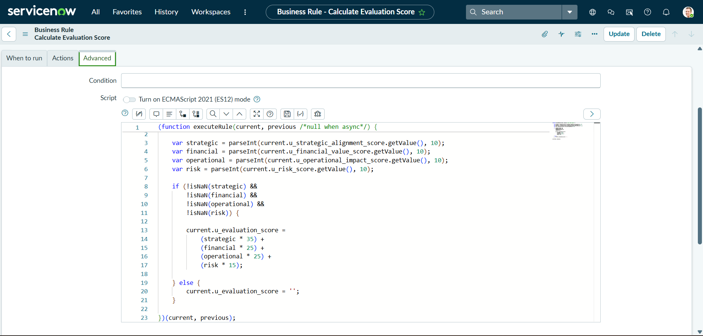

Because the rule executes **before** the database operation, the calculated Evaluation Score is assigned directly to the current record and is included in the same save operation. Therefore, `current.update()` is not required. Avoiding an additional update also reduces the risk of recursive Business Rule execution.

## Governance Lifecycle

Investment proposals progress through a controlled governance lifecycle:

**Draft → Submitted → Under Review → Approved, Deferred, or Rejected**

The available governance statuses are:

| Status | Purpose |
|---|---|
| Draft | Proposal is being prepared by the requestor |
| Submitted | Proposal has been submitted for governance consideration |
| Under Review | Proposal is being assessed by a governance reviewer |
| Approved | Proposal has received final approval |
| Deferred | Decision has been postponed, or the proposal requires further consideration |
| Rejected | Proposal has not been approved |

### Approval Score Threshold

To strengthen governance control, a proposal can only progress to **Approved** status when its Evaluation Score is at least **350**.

If an approval is attempted with an Evaluation Score below 350, the update is rejected, and the user is informed that the proposal does not meet the minimum approval threshold.

This ensures that the weighted evaluation model is used not only for proposal comparison and reporting, but also as an active control within the governance decision process.

### Governance Status Transition Control

A **Before Business Rule** named **Validate Governance Status Transition** was configured to ensure that proposals follow the defined governance process.

The permitted transitions are:

- Draft → Submitted
- Submitted → Under Review
- Under Review → Approved
- Under Review → Deferred
- Under Review → Rejected

The Business Rule prevents users from bypassing or reversing the governance process. For example, a proposal cannot move directly from **Submitted to Approved**, and a proposal already **Under Review** cannot be moved backwards to **Submitted**.

The rule is configured to run only when the Governance Status changes. This means that normal updates to other proposal fields do not trigger the governance transition validation unnecessarily.

### Governance Transition Business Rule Configuration

The **Validate Governance Status Transition** Business Rule executes before an update when the Governance Status changes. It validates the requested status change against the permitted lifecycle transitions before the record is saved.

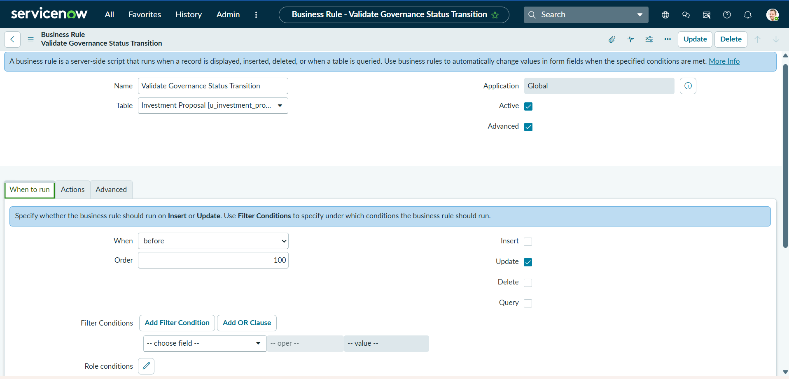

The server-side validation logic prevents proposals from bypassing governance stages or moving backwards through the lifecycle.

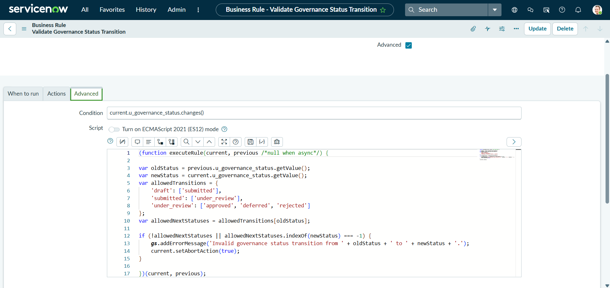

## Role-Based Access Control

The application uses role-based access control to separate proposal submission responsibilities from governance decision-making.

Two functional roles were created:

| Role | Responsibility |
|---|---|
| `investment_proposal_requestor` | Allows authorised users to create and maintain investment proposal information |
| `investment_governance_reviewer` | Allows authorised governance users to review proposals and manage governance decisions |

Both functional roles inherit the base application role `u_investment_proposal_user`, providing access to the Investment Proposal application and its records.

### Governance Status Security

Table-level ACLs allow authorised requestors and governance reviewers to read and update Investment Proposal records.

A separate field-level **Write ACL** was configured for `u_investment_proposal.u_governance_status`. Only users with the `investment_governance_reviewer` role are granted direct write access to the Governance Status field.

The following field-level ACL restricts direct write access to Governance Status to users with the `investment_governance_reviewer` role.

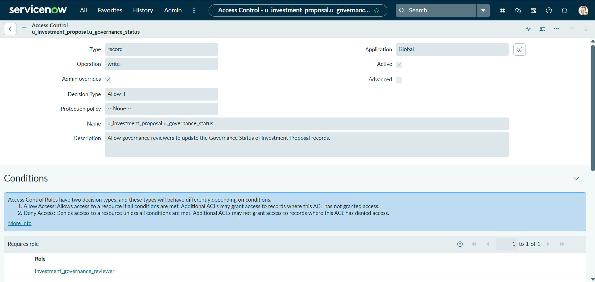

The role-based behaviour was also validated using the same Investment Proposal record with different users. For the Proposal Requestor, Governance Status remained read-only, while the Governance Reviewer was able to edit the field.

**Proposal Requestor view:**


**Governance Reviewer view:**

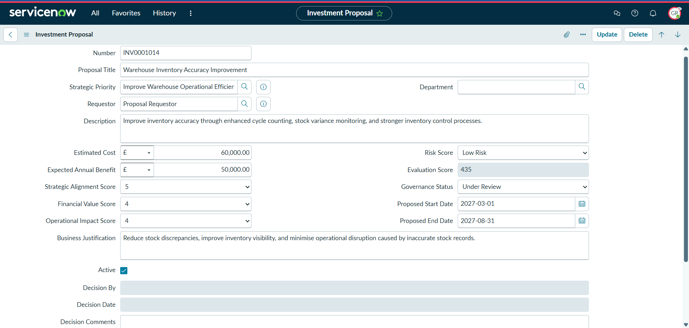

As a result:

- Proposal requestors can edit normal proposal information, but Governance Status remains read-only.
- Governance reviewers can edit Governance Status and progress proposals through the governance lifecycle.

This prevents requestors from directly approving, deferring, rejecting, or otherwise manipulating the governance state of their own proposals.

### Strategic Priority Access

Because the Strategic Priority field references the ServiceNow Goal Framework table `sn_gf_strategy`, users also require read access to that table.

Rather than modifying the existing ServiceNow ACL, the required `sn_gf.strategy_planner_read` role was inherited by both application roles. This allows requestors and reviewers to view and select Strategic Priority records while preserving the security controls provided by the Goal Framework.

## Controlled Proposal Submission

Because proposal requestors do not have direct write access to the **Governance Status** field, a controlled submission mechanism was required to allow them to move a completed proposal from **Draft** to **Submitted**.

A server-side **UI Action** named **Submit Proposal** was created on the Investment Proposal table.

The button is displayed only when:

- The proposal is currently in Draft status.
- The logged-in user has the `investment_proposal_requestor` role.

### Submit Proposal UI Action Configuration

The UI Action is configured as an active **Form button** that is available on existing Investment Proposal records when its defined condition is met. It provides requestors with a controlled submission mechanism without making the Governance Status field directly editable.

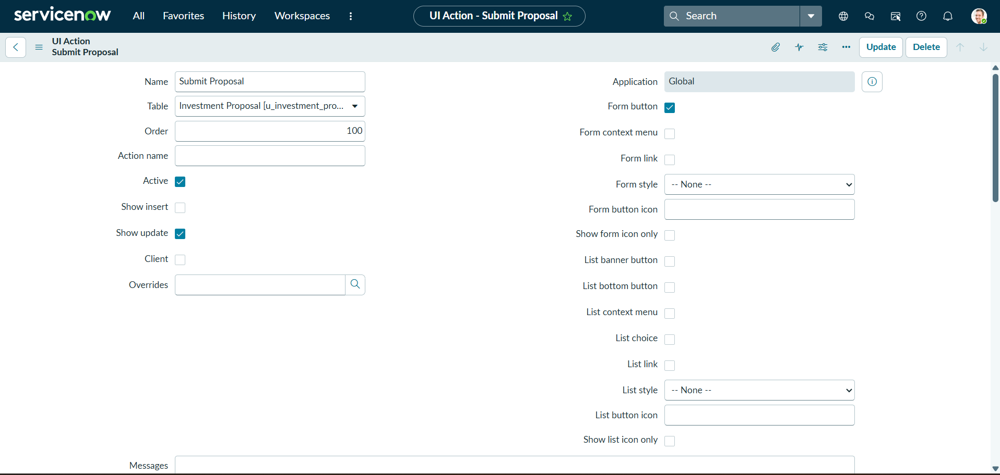

The condition restricts the action to proposals in Draft status and users with the `investment_proposal_requestor` role. The server-side script then changes the Governance Status to Submitted, saves the record, displays a confirmation message, and redirects the requestor back to the proposal.

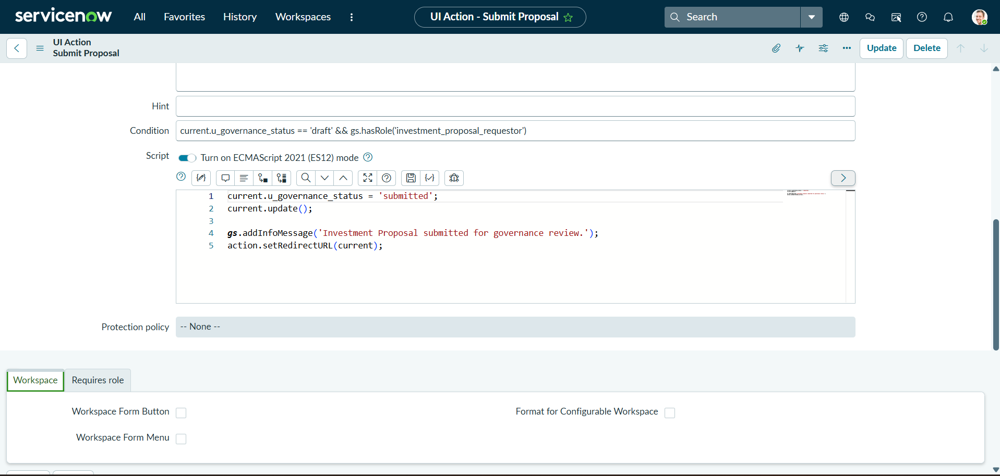

The following condition controls when the button is displayed:

```javascript
current.u_governance_status == 'draft' && gs.hasRole('investment_proposal_requestor')
```

When selected, the UI Action changes the Governance Status to Submitted, saves the record, displays a confirmation message, and redirects the requestor back to the proposal.

```javascript
current.u_governance_status = 'submitted';
current.update();

gs.addInfoMessage('Investment Proposal submitted for governance review.');
action.setRedirectURL(current);
```

The UI Action uses `current.update()` because, unlike a Before Business Rule, it is not already executing as part of a pending database save. The status change therefore needs to be explicitly saved.

This design allows requestors to perform the specific **Draft → Submitted** transition while the Governance Status field remains read-only to them. Governance control is therefore maintained without granting requestors broader write access to the field.

## Governance Decision Controls and Audit

The application includes additional controls for final governance decisions to improve accountability and ensure that important decision information is captured consistently.

### Decision Comments

A **UI Policy** was configured to make **Decision Comments** mandatory when the Governance Status is either **Deferred** or **Rejected**.

Decision Comments remain optional when a proposal is Approved.

This ensures that reviewers provide supporting justification when an investment proposal is not approved or when a decision is postponed.

### Automated Decision Audit

A **Before Business Rule** named **Record Governance Decision** was configured to automatically capture the user responsible for a final governance decision and the date and time when the decision was made.

The rule runs when Governance Status changes and records decision information when the new status is:

- Approved
- Deferred
- Rejected

The Business Rule uses the following logic:

```javascript
(function executeRule(current, previous /*null when async*/) {

    var newStatus = current.u_governance_status.getValue();

    if (newStatus == 'approved' || newStatus == 'deferred' || newStatus == 'rejected') {
        current.u_decision_by = gs.getUserID();
        current.u_decision_date = gs.nowDateTime();
    }

})(current, previous);
```

`gs.getUserID()` identifies the currently logged-in user making the decision, while `gs.nowDateTime()` records the date and time of the decision.

Because this is a Before Business Rule, the Decision By and Decision Date values are included in the same database operation that saves the governance status change. No additional `current.update()` is required.

### Governance Decision Business Rule Configuration

The **Record Governance Decision** Business Rule runs before an update when Governance Status changes. It automatically captures governance decision information when a proposal reaches Approved, Deferred, or Rejected status.

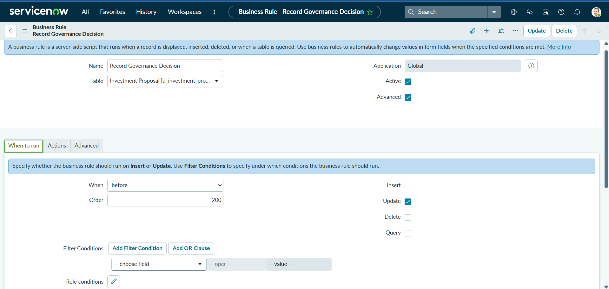

The Advanced configuration contains the server-side logic used to populate Decision By and Decision Date.

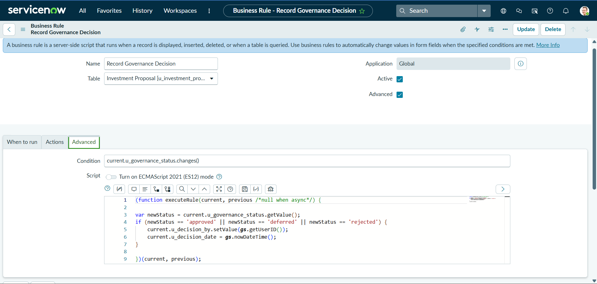

### Decision Control Validation

The following rejected proposal demonstrates the completed governance decision controls. **Decision Comments** is mandatory for the rejected outcome, while **Decision By** and **Decision Date** have been automatically populated to provide an audit trail.

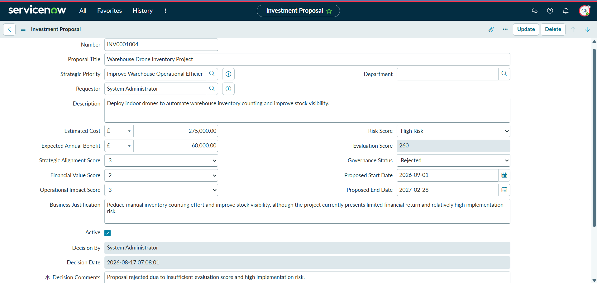

Together, the mandatory Decision Comments control and automated decision audit provide a clearer record of governance outcomes and accountability for final investment decisions.

## Reporting and Analytics

Reporting and analytics were configured to provide visibility of the investment portfolio and support governance decision-making.

### Core UI Reports

Three reports were created using ServiceNow Core UI reporting:

1. **Investment Proposals by Governance Status**  
   A bar chart showing the number of proposals at each stage of the governance lifecycle.

#### Investment Proposals by Governance Status

This report provides a count of Investment Proposals grouped by Governance Status, making it easy to see how proposals are distributed across the governance lifecycle.

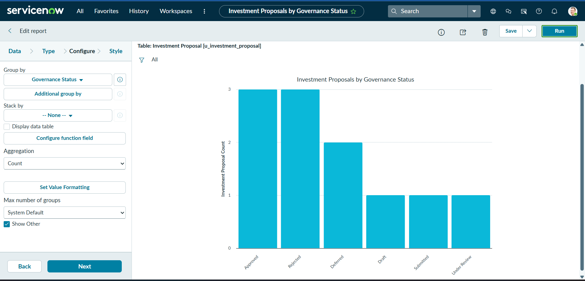

2. **Investment Proposal Evaluation Scores**  
   A bar chart comparing the average Evaluation Score by Proposal Title, allowing individual proposals to be compared based on their weighted assessment.

#### Investment Proposal Evaluation Scores

This report compares individual proposals using their Evaluation Scores, providing a clear view of the relative strength of proposals based on the weighted evaluation model.

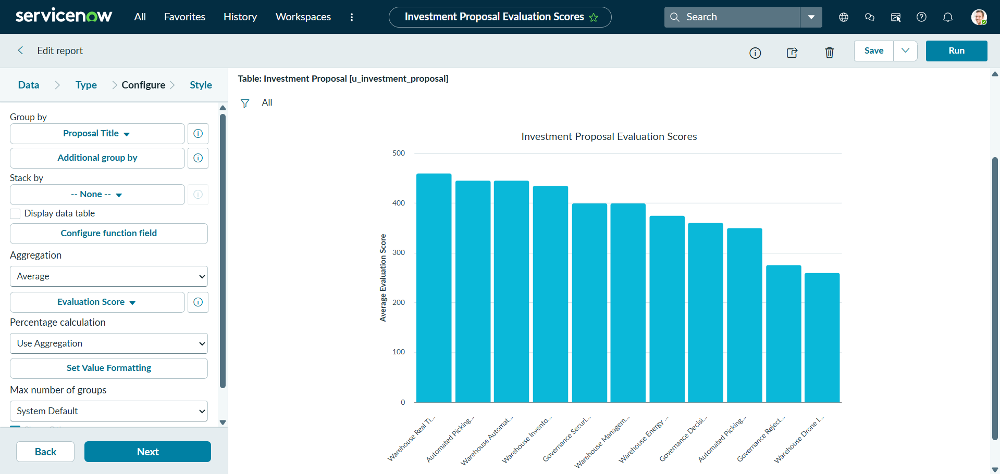

3. **Investment Cost vs Expected Benefit**  
   A bubble chart comparing Estimated Cost against Expected Annual Benefit for each proposal, with bubble size representing the Evaluation Score. This provides a three-dimensional view of investment cost, expected financial benefit, and overall evaluation strength.

#### Investment Cost vs Expected Benefit

This bubble report compares **Estimated Cost** against **Expected Annual Benefit** for each proposal, while bubble size represents the **Evaluation Score**. It provides a three-dimensional view of cost, expected financial benefit, and overall evaluation strength.

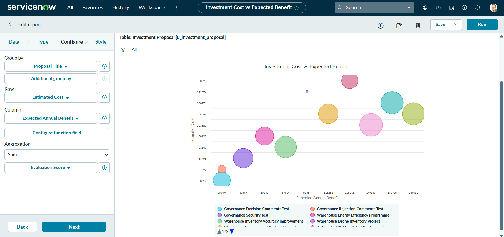

### Strategic Investment Governance Dashboard

An interactive **Strategic Investment Governance Dashboard** was created using Platform Analytics.

The dashboard contains:

- **Total Investment Proposals**: a single score showing the total number of proposals in the portfolio.
- **Investment Proposals by Governance Status**: a donut chart showing the distribution of proposals across the governance lifecycle.
- **Average Evaluation Score by Governance Status**: a horizontal bar chart comparing average evaluation performance across governance stages.
- **Investment Proposal Governance Review**: a proposal-level list displaying Number, Business Justification, Evaluation Score, and Governance Status.

The Governance Status donut chart and Average Evaluation Score chart were configured with **Apply as filter** interaction. Selecting a value in either visualisation dynamically filters the Governance Review list, allowing governance users to investigate specific segments of the portfolio.

A dashboard guide was also included to explain that Evaluation Scores range from **100 to 500**, with higher scores representing stronger overall investment value.

### Dashboard Implementation

The completed dashboard provides a consolidated governance view of the investment portfolio. It combines proposal volume, lifecycle distribution, average evaluation performance, and proposal-level governance information in a single interactive interface.

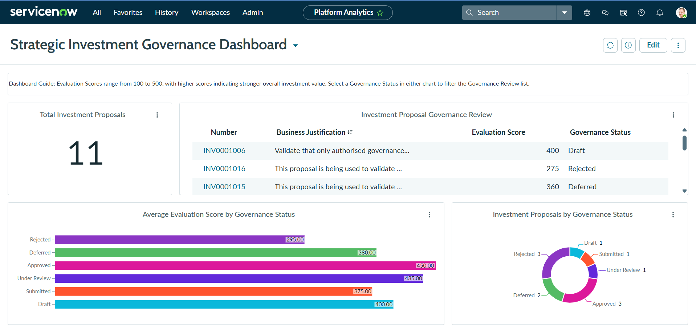

The dashboard was tested with proposals distributed across all six lifecycle statuses: **Draft, Submitted, Under Review, Approved, Deferred, and Rejected**. This provides representative portfolio data for validating both governance visibility and interactive filtering.

Selecting a Governance Status from the donut chart or a status from the Average Evaluation Score visualisation applies the selection as a filter to the Governance Review list, allowing reviewers to focus on specific segments of the investment portfolio.

Together, the reports and dashboard provide both proposal-level and portfolio-level visibility to support investment evaluation, governance monitoring, and decision-making.

## Testing and User Acceptance Testing

The application was tested using separate **Proposal Requestor** and **Governance Reviewer** users to validate functionality, security controls, governance behaviour, and automated processes.

Testing included the following scenarios:

| Test Scenario | Expected Result | Result |
|---|---|---|
| Create an investment proposal | Requestor can create and maintain proposal information | Passed |
| Automatic Evaluation Score calculation | Evaluation Score is calculated from the four weighted assessment criteria | Passed |
| Strategic Priority selection | Authorised users can view and select Strategic Priority records | Passed |
| Requestor Governance Status access | Governance Status remains read only for the requestor | Passed |
| Submit Proposal UI Action | Requestor can move a proposal from Draft to Submitted using the controlled submission button | Passed |
| Reviewer Governance Status access | Governance Reviewer can update Governance Status | Passed |
| Submitted → Under Review | Valid governance transition is permitted | Passed |
| Submitted → Approved | Invalid direct transition is blocked | Passed |
| Under Review → Submitted | Invalid backward transition is blocked | Passed |
| Under Review → Approved | Valid final governance transition is permitted | Passed |
| Deferred or Rejected decision | Decision Comments becomes mandatory | Passed |
| Final governance decision | Decision By and Decision Date are populated automatically | Passed |
| Dashboard interaction | Selecting governance data in interactive charts filters the Governance Review list | Passed |

### End-to-End UAT Example

An **Automated Picking System Expansion** proposal was created as the Proposal Requestor with realistic cost, benefit, strategic, operational, financial, and risk information.

The weighted scoring logic automatically produced an **Evaluation Score of 445**.

The requestor submitted the proposal using the **Submit Proposal** UI Action. A Governance Reviewer then progressed the proposal from **Submitted → Under Review**.

An attempted backward transition from **Under Review → Submitted** was successfully blocked by the governance transition control.

The reviewer then approved the proposal using the valid **Under Review → Approved** transition. The application automatically populated **Decision By** and **Decision Date**, confirming that the governance decision audit functionality operated as designed.

Additional proposals were deliberately retained at **Submitted** and **Under Review** stages to verify lifecycle visibility and provide representative portfolio data across the governance dashboard.

### Governance Control Validation

Negative testing was performed to confirm that the application prevents invalid governance actions rather than relying only on users to follow the defined process.

#### Invalid Lifecycle Transition

An attempt was made to move a proposal directly from **Submitted** to **Approved**, bypassing the required **Under Review** stage. The update was rejected by the governance transition validation logic.

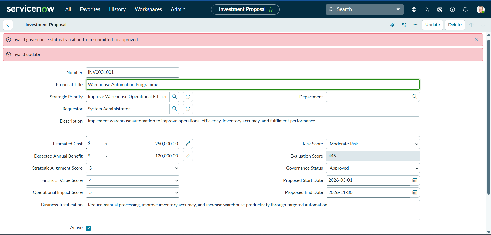

#### Approval Score Threshold

A proposal with an Evaluation Score of **260** was tested for approval. The application prevented the approval because the Evaluation Score was below the required minimum threshold of **350**.

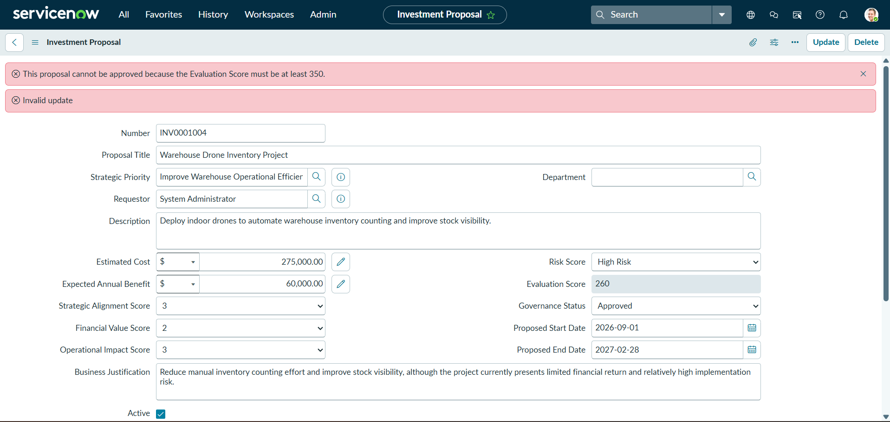

#### Mandatory Decision Comments

A Deferred proposal was tested without entering Decision Comments. The application prevented the record from being saved and identified **Decision Comments** as a mandatory field.

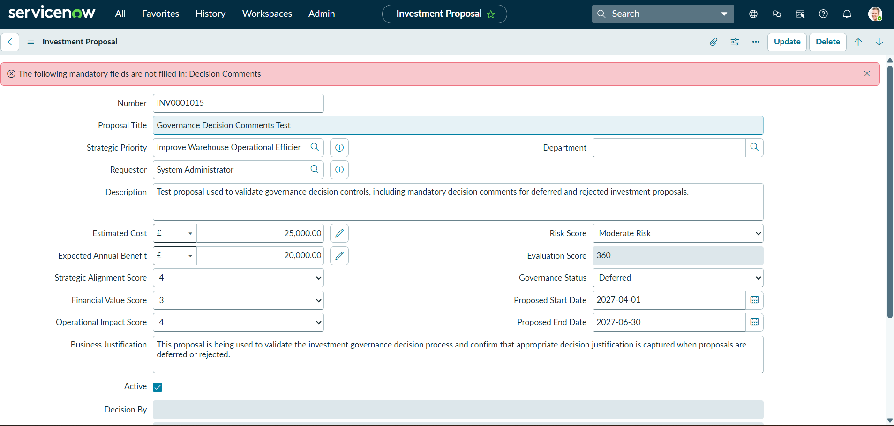

These tests demonstrate that governance controls are actively enforced by the application, including lifecycle sequencing, minimum approval criteria, and decision justification requirements.

## Troubleshooting and Lessons Learned

During development and testing, several issues required investigation and provided useful ServiceNow troubleshooting experience.

### Strategic Priority Reference Access

During testing with the Proposal Requestor account, the **Strategic Priority** reference field did not display the expected Strategic Priority records.

Investigation of the field dictionary confirmed that the field references the ServiceNow Goal Framework Strategic Priority table (`sn_gf_strategy`). Further investigation of the table security identified that read access requires the `sn_gf.strategy_planner_read` role.

Rather than modifying the existing ServiceNow ACL, the required read role was inherited by both the `investment_proposal_requestor` and `investment_governance_reviewer` roles.

This resolved the issue while preserving the existing Goal Framework security model.

### Decision By Reference Field

During governance decision testing, the **Decision By** field initially displayed a 32-character `sys_id` instead of the user's display name.

Dictionary investigation revealed that the field had been configured to reference an incorrect custom table rather than the standard ServiceNow User table.

The Reference Specification was corrected to the standard User table (`sys_user`). Existing Decision By values then displayed the appropriate user name instead of the raw `sys_id`.

This demonstrated the importance of verifying the underlying table name and reference configuration when troubleshooting reference fields, rather than relying only on the displayed table label.

### Key Lessons

The project reinforced several ServiceNow development and administration principles:

- Use Before Business Rules to modify the current record before it is saved without performing an unnecessary `current.update()`.
- Use field-level ACLs when access to a specific field requires tighter control than access to the overall record.
- Preserve existing ServiceNow security controls where possible rather than modifying out-of-box ACLs unnecessarily.
- Use controlled UI Actions to provide specific user actions without granting broader field permissions.
- Verify both the display label and internal table name when configuring and troubleshooting reference fields.
- Test functionality using users with the actual application roles rather than relying solely on the administrator account.
- Test both successful and unsuccessful governance scenarios to confirm that business controls operate as intended.

## Skills Demonstrated

This project demonstrates practical experience across ServiceNow administration, configuration, scripting, security, governance, and analytics.

### ServiceNow Configuration

- Custom table and field configuration
- Reference field configuration
- Choice field configuration
- Application menu and module configuration
- Form configuration
- UI Policies
- UI Actions
- Platform Analytics dashboards
- Core UI reports

### Server Side Development

- Before Business Rules
- GlideSystem methods including `gs.getUserID()` and `gs.nowDateTime()`
- Field value retrieval using `.getValue()`
- Field change detection using `.changes()`
- Conditional logic and validation
- Automated weighted score calculation
- Governance lifecycle validation
- Automated decision auditing

### Security and Access Control

- Role-based access control
- Custom application roles
- Role inheritance
- Table-level ACLs
- Field-level ACLs
- Reference table access troubleshooting
- Separation of requestor and governance reviewer responsibilities

### Testing and Troubleshooting

- Role-based functional testing
- End-to-end user acceptance testing
- Positive and negative test scenarios
- Governance transition testing
- ACL and reference field troubleshooting
- Dictionary configuration investigation
- Validation of automated Business Rule behaviour

### Business and Governance Design

- Strategic investment proposal management
- Weighted investment evaluation
- Strategic priority alignment
- Governance workflow design
- Decision accountability and auditability
- Cost and expected benefit analysis
- Portfolio-level reporting and analytics

## Project Outcome

The completed solution demonstrates how ServiceNow can be configured to support a structured and auditable investment governance process.

The application provides:

- Centralised capture of strategic investment proposals.
- Alignment of proposals with organisational Strategic Priorities.
- Automated weighted evaluation using strategic, financial, operational, and risk criteria.
- Controlled progression through a defined governance lifecycle.
- Separation of requestor and governance reviewer responsibilities through role-based access control.
- Controlled proposal submission without exposing Governance Status directly to requestors.
- Automated capture of governance decision accountability.
- Mandatory justification for Deferred and Rejected decisions.
- Portfolio-level reporting and interactive analytics.
- A tested process covering both valid and invalid governance scenarios.

The project combines ServiceNow administration, configuration, server-side scripting, security, reporting, analytics, troubleshooting, and business process design within a single end-to-end implementation.
